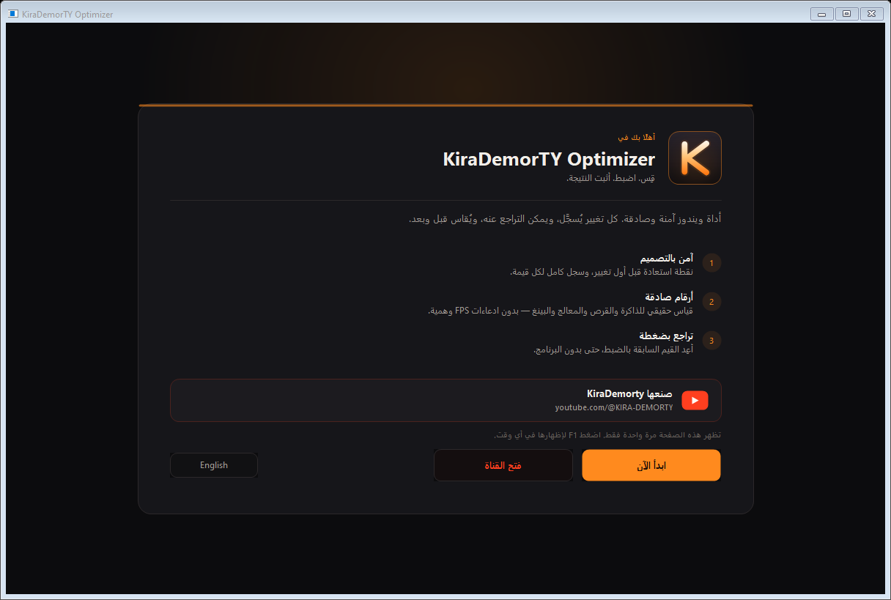
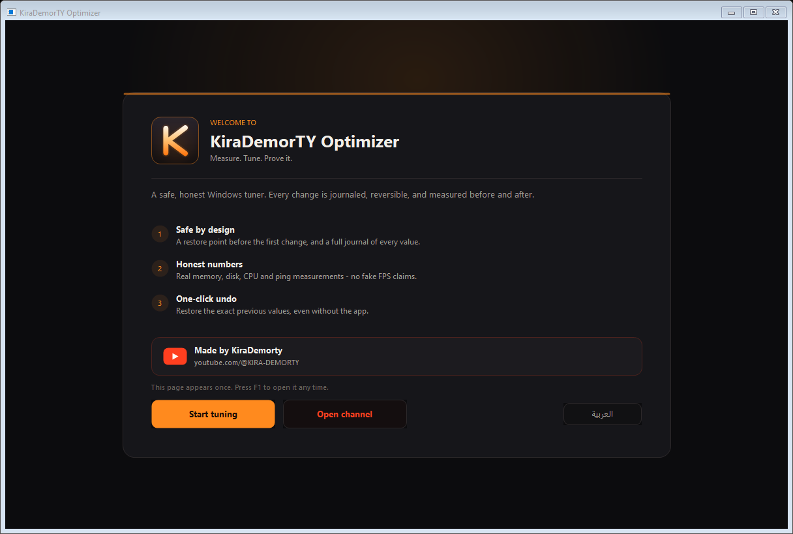
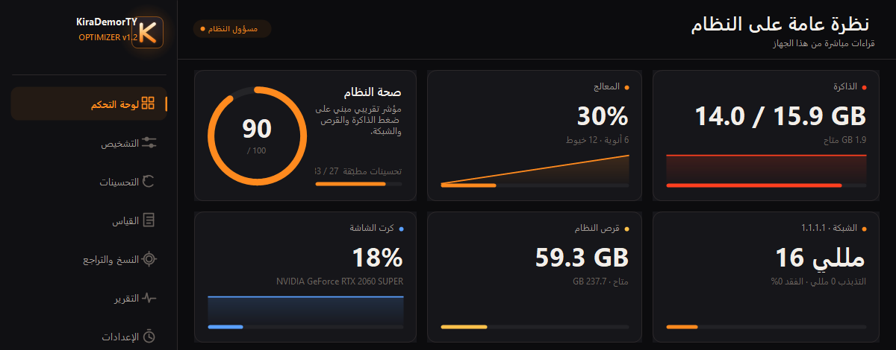
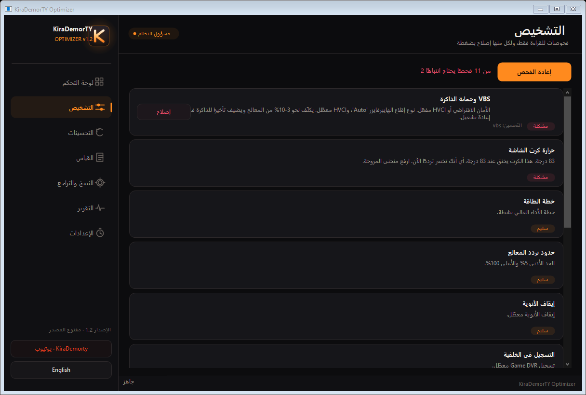

# KiraDemorTY Optimizer (KDT)

**أداة مفتوحة المصدر لتقليل التقطيع ورفع استقرار الأداء في ويندوز — تقيس، تضبط، وتُثبت النتيجة.**
**Open-source Windows latency and stutter tuner. Measure. Tune. Prove it.**

`v1.2` · Windows 10/11 · ملف تنفيذي واحد (~280 KB) · بدون تثبيت · بدون تتبّع · بدون إعلانات

| العربية | English |
|---|---|
|  |  |
|  |  |

> المزيد في [`docs/screens/`](docs/screens): التحسينات، القياس، الإعدادات، ونسخة إنجليزية.

---

## بالعربية

### ما هذا البرنامج؟

**KiraDemorTY Optimizer** أداة صغيرة تعمل بصلاحيات المسؤول، تُطبّق 33 تحسينًا معروفًا في ويندوز
لتقليل التقطيع (stutter) وتحسين ثبات زمن الإطار، مع تسجيل كل تغيير حتى تستطيع التراجع عنه بالضبط.

البرنامج لا يبيع لك وهمًا: لا يقول «+300% FPS»، ولا ينظّف الريجستري، ولا يعطّل الحماية،
ولا يحذف أي ملف شخصي. هو يعرض **حالة جهازك الحقيقية**، يفحص المشاكل الشائعة، ويطبّق تغييرات
**قابلة للعكس**، ويقيس **قبل/بعد**، ثم يُنشئ **تقريرًا** بأرقامك الفعلية لتشاركها.

**قناة KiraDemorty على يوتيوب:** [youtube.com/@KIRA-DEMORTY](https://www.youtube.com/@KIRA-DEMORTY)
— البرنامج مجاني ومفتوح المصدر لمتابعي القناة.

### المزايا

| | |
|---|---|
| **7 صفحات** | لوحة التحكم، التشخيص، التحسينات، القياس، النسخ والتراجع، التقرير، الإعدادات |
| **33 تحسينًا** | طاقة، جدولة معالج، GPU، شبكة، أولوية ألعاب، خدمات، واجهة |
| **صفحة ترحيب** | تظهر عند أول تشغيل: الفكرة، ثلاث قواعد أمان، ورابط القناة (وتُفتح لاحقًا بـ F1) |
| **روابط القناة** | الشريط الجانبي، صفحة الترحيب، الإعدادات، وتذييل التقرير |
| **مرشّحات** | الكل / آمن / متوسط / متقدم مع عدّاد «مطبّق من المجموع» |
| **تنبيه إعادة التشغيل** | شارة في الشريط العلوي عند وجود تغيير ينتظر إعادة تشغيل، والضغط عليها ينقلك للتحسينات |
| **اختصارات** | Ctrl+1..7 للتنقل بين الصفحات، F1 لصفحة الترحيب، Esc لإغلاقها |
| **فحص تشخيصي** | 11 فحصًا للقراءة فقط، ولكل مشكلة إصلاح بضغطة عبر نفس مسار التراجع |
| **قياس قبل/بعد** | تأخير الذاكرة، قراءة القرص 4K، عمليات المعالج، البينغ والتذبذب |
| **تراجع كامل** | كل قيمة ريجستري تُحفظ بنوعها وبياناتها، وتراجع بضغطة واحدة |
| **سكربت تراجع** | تصدير PowerShell يعكس كل تغيير حتى بدون البرنامج |
| **نقطة استعادة** | تُنشأ تلقائيًا قبل أول تغيير |
| **واجهة عربية/إنجليزية** | تبديل فوري أثناء التشغيل |
| **قراءات مباشرة** | معالج، رام، GPU، القرص، بينغ/تذبذب/فقد |
| **تقرير HTML** | عتادك + حالة كل تحسين + مقارنة قبل/بعد + قائمة التغييرات الدقيقة |
| **هوية برتقالية** | ثيم وأيقونة خاصة بهوية قناة KiraDemorTY |

### التحسينات الثلاثة والثلاثون

| التحسين | الخطورة | يحتاج إعادة تشغيل |
|---|---|---|
| خطة الطاقة عالية الأداء | آمن | — |
| حد المعالج الأدنى 5% والأعلى 100% | متوسط | — |
| تعطيل إيقاف أنوية المعالج (Core Parking) | متوسط | — |
| تعطيل توفير طاقة PCIe (ASPM) | متوسط | — |
| تعطيل تعليق USB الانتقائي | آمن | — |
| تعطيل خنق الطاقة (Power Throttling) | متوسط | — |
| تعطيل جدولة GPU العتادية (HAGS) | متقدم | نعم |
| تفعيل وضع الألعاب (Game Mode) | آمن | — |
| تعطيل تسجيل Game DVR | آمن | — |
| تعطيل تحسينات ملء الشاشة (FSE) | آمن | — |
| استجابة الوسائط وأولوية مهمة الألعاب (MMCSS) | متوسط | — |
| تعطيل خنق الشبكة (NetworkThrottlingIndex) | آمن | — |
| أولوية المعالج للبرنامج الأمامي (38) | متوسط | — |
| إزالة تأخير برامج البدء | آمن | — |
| تعطيل Nagle لتقليل زمن الاستجابة | متوسط | إعادة اتصال |
| تعطيل VBS و HVCI | متقدم | نعم |
| تعطيل تسريع مؤشر الفأرة | آمن | إعادة تسجيل الدخول |
| تأثيرات بصرية: أفضل أداء | آمن | — |
| تعطيل شفافية ويندوز | آمن | — |
| إيقاف تطبيقات المتجر في الخلفية | آمن | — |
| قوائم فورية بدون تأخير 400 مللي | آمن | إعادة تشغيل Explorer |
| تعطيل اقتراحات البحث من الويب | آمن | — |
| تفعيل TRIM للقرص الصلب | آمن | — |
| تعطيل بدء التشغيل السريع | آمن | — |
| إيقاف مشاركة تحديثات ويندوز بين الأجهزة (P2P) | آمن | — |
| تعطيل تقارير أخطاء ويندوز | متوسط | — |
| إخفاء لوحة Game Bar عند بدء اللعبة | آمن | — |
| مؤقت النظام عالي الدقة (1 مللي) | متوسط | نعم |
| إبقاء القرص SSD مستيقظًا (مهلة الخمول) | آمن | — |
| إيقاف الصيانة التلقائية في الخلفية | متوسط | — |
| تعطيل نصائح واقتراحات ويندوز | آمن | — |
| تحرير عرض النطاق المحجوز (QoS) | آمن | — |
| تعطيل خدمة القياس (DiagTrack) | متوسط | — |

> **VBS/HVCI:** لا تستخدمه إذا كنت تشغّل Hyper-V أو WSL2 أو أجهزة افتراضية أو Docker.
> **تعطيل خدمة DiagTrack** يفشل بأمان إذا كانت الخدمة غير موجودة في نسختك من ويندوز.

### الأمان — ما يفعله البرنامج قبل أي تغيير

1. ينشئ **نقطة استعادة** في ويندوز (قد يتخطاها ويندوز إذا وُجدت نقطة خلال 24 ساعة).
2. يحفظ **القيمة السابقة بالضبط** لكل قيمة ريجستري (النوع + البيانات) في سجل `journal.tsv`.
3. يحفظ القيمة السابقة لإعدادات الطاقة وأوامر الإقلاع في أمر التراجع نفسه.
4. أي ضغط على مفتاح = تراجع عن هذا التحسين تحديدًا، وزر واحد = تراجع عن كل شيء.
5. يمكنك **تصدير سكربت تراجع** من صفحة النسخ والتراجع يعمل حتى لو حُذف البرنامج.

### ما لا يفعله البرنامج أبدًا

- لا تنظيف للريجستري ولا «تسريع وهمي».
- لا مقويات رام وهمية.
- لا تعطيل للدفيندر أو تحديثات ويندوز.
- لا مثبّتات تعاريف ولا برامج مرفقة ولا إعلانات.
- لا حذف أو لمس للملفات الشخصية.
- لا إرسال أي بيانات إلى أي خادم (لا تتبّع، لا تحليلات).

### التشغيل

1. نزّل `KiraDemorTY-Optimizer.exe` من صفحة الإصدارات.
2. شغّله كمسؤول (سيطلب ويندوز ذلك تلقائيًا) — ستظهر **صفحة الترحيب** أول مرة؛ اقرأها ثم اضغط **ابدأ الضبط**.
3. افتح **التشخيص** واضغط **إعادة الفحص**؛ عالج ما يظهر بضغطة **إصلاح**.
4. افتح **القياس** واضغط **تنفيذ القياس** — أول قياس يُحفظ كخط أساس تلقائيًا.
5. راجع لوحة التحكم، ثم **التحسينات** واضغط **تطبيق الموصى به** أو فعّل ما تريد.
6. أعد تشغيل ويندوز للتحسينات التي تحتاج ذلك، ثم أعد القياس من صفحة **القياس** لترى الفرق.
7. من صفحة **التقرير** أنشئ تقرير HTML يضم المقارنة قبل/بعد.

**بيانات البرنامج:** `%LOCALAPPDATA%\KiraDemorTY Optimizer` (السجل، الإعدادات، النسخ).

### لماذا قد يظهر تحذير SmartScreen؟

الملف غير موقّع رقميًا (شهادة التوقيع تكلّف ~250$ سنويًا). هذا طبيعي لأي برنامج جديد.
الكود المصدري كامل في هذا المستودع، ويمكنك بناء الملف بنفسك في ثوانٍ:
انظر قسم **Build** أدناه. لا تشغّل نسخة من مصدر لا تثق به.

### بناء من المصدر

لا تحتاج Visual Studio ولا .NET SDK — يكفي `csc.exe` الموجود في ويندوز:

```powershell
# نسخة المسؤول (النهائية)
powershell -ExecutionPolicy Bypass -File .\build.ps1

# نسخة تطوير بدون مانيفست المسؤول (للتجريب فقط)
powershell -ExecutionPolicy Bypass -File .\build.ps1 -Dev
```

الناتج: `dist\KiraDemorTY-Optimizer.exe`

اختبار المحرك (تطبيق/تراجع/تقرير/تشخيص/قياس) بدون لمس إعداداتك — 51 فحصًا:

```powershell
# يبني ويشغّل أدوات\سيلفتست، ويستعيد سجلّك الأصلي في النهاية
powershell -ExecutionPolicy Bypass -File .\tools\run-selftest.ps1
```

توليد الأيقونة (7 أحجام، 16-256 بكسل):

```powershell
powershell -ExecutionPolicy Bypass -File .\tools\make-icon.ps1
```

### نتائج صادقة

البرنامج لا يَعِد بأرقام. التقطيع ينتج عن أسباب مختلفة (حرارة، حد طاقة، رام ممتلئة،
قرص بطيء، شبكة، لعبة نفسها). بعض التحسينات قد لا تُغيّر شيئًا على جهازك — ولهذا
يوجد زر تراجع، وتقرير يقيس ما حدث فعلًا.

### الوثائق

- [`docs/VIDEO-SCRIPT.md`](docs/VIDEO-SCRIPT.md) — سكربت فيديو الشرح الكامل: العنوان، الوصف،
  الفصول، التعليق الصوتي مشهدًا بمشهد، لقطات B-roll، وقائمة ما لا يجب قوله.
- [`docs/PUBLISH-GITHUB.md`](docs/PUBLISH-GITHUB.md) — نشر المشروع على GitHub خطوة بخطوة،
  من تثبيت Git إلى أول إصدار وبصمة SHA-256.
- [`CHANGELOG.md`](CHANGELOG.md) — كل تغيير في كل إصدار.
- [`CONTRIBUTING.md`](CONTRIBUTING.md) — كيف تبني وتختبر قبل إرسال Pull Request.

---

## English

### What is it?

**KiraDemorTY Optimizer** is a small, admin-only Windows utility that applies 33 well-known
tweaks targeting stutter and frame-time consistency — and journals every single change so you
can undo it exactly.

No registry cleaning. No fake RAM boosters. No "+300% FPS" marketing. It shows the real state
of the machine, scans for common misconfigurations, applies reversible changes, measures
before/after, and writes a report with your actual numbers.

**YouTube channel:** [youtube.com/@KIRA-DEMORTY](https://www.youtube.com/@KIRA-DEMORTY) —
free and open source for the channel's viewers.

### Features

- **7 pages** — dashboard, diagnostics, tweaks, benchmark, backup & undo, report, settings.
- **33 tweaks** across power, CPU scheduling, GPU, networking, foreground priority, services and UI.
- **Welcome page** on first launch — the idea, three safety rules and the channel link; reopen it
  any time with **F1**.
- **Channel links** in the sidebar, the welcome page, settings and the report footer.
- **Tweak filters** — All / Safe / Moderate / Advanced, plus an "applied of total" counter.
- **Pending-reboot badge** in the top bar; clicking it jumps to the tweaks page.
- **Shortcuts** — Ctrl+1..7 for pages, F1 for the welcome page, Esc to close it.
- **Diagnostics** — 11 read-only checks; every finding offers a one-click fix that goes
  through the same journaled, undoable path as a normal tweak.
- **Before/after benchmark** — memory latency, 4K random read, CPU integer throughput,
  ping and jitter. The first run becomes your baseline automatically.
- **Exact undo** — every registry value is stored with its type and data; one click reverts all.
- **Undo script export** — a standalone PowerShell script that reverts every journaled change.
- **Restore point** created before the first change.
- **Bilingual UI** (Arabic/English) switchable at runtime.
- **Live readings** — CPU, RAM, GPU, disk, ping/jitter/loss.
- **HTML report** — hardware, tweak states, benchmark comparison and the precise change list.
- **KiraDemorTY orange theme** — warm dark UI and a matching custom icon.

### The 33 tweaks

| Tweak | Risk | Reboot |
|---|---|---|
| High performance power plan | safe | – |
| CPU min 5% / max 100% | moderate | – |
| Disable core parking | moderate | – |
| Disable PCIe ASPM | moderate | – |
| Disable USB selective suspend | safe | – |
| Disable Power Throttling | moderate | – |
| Disable hardware GPU scheduling (HAGS) | advanced | yes |
| Enable Game Mode | safe | – |
| Disable Game DVR recording | safe | – |
| Disable fullscreen optimizations | safe | – |
| MMCSS + Games task priority | moderate | – |
| Disable network throttling | safe | – |
| Foreground priority separation (38) | moderate | – |
| Remove startup app delay | safe | – |
| Disable Nagle (lower latency) | moderate | reconnect |
| Disable VBS + HVCI | advanced | yes |
| Disable mouse acceleration | safe | sign out |
| Visual effects: best performance | safe | – |
| Disable Windows transparency | safe | – |
| Stop background Store apps | safe | – |
| Instant menus (no 400 ms delay) | safe | Explorer |
| Disable web search suggestions | safe | – |
| Enable SSD TRIM | safe | – |
| Disable Fast Startup | safe | – |
| Stop peer-to-peer update sharing | safe | – |
| Disable Windows Error Reporting | moderate | – |
| Hide the Game Bar startup panel | safe | – |
| High-resolution system timer (1 ms) | moderate | yes |
| Keep the SSD awake (idle timeout) | safe | – |
| Pause Automatic Maintenance | moderate | – |
| Disable Windows tips and suggestions | safe | – |
| Release reserved network bandwidth (QoS) | safe | – |
| Disable the telemetry service (DiagTrack) | moderate | – |

> **VBS/HVCI:** do not apply if you use Hyper-V, WSL2, virtual machines or Docker.
> **DiagTrack** fails safely when the service does not exist on your Windows edition.

### Safety model

1. A Windows **restore point** is requested before the first change.
2. Each registry value is saved with its **exact type and data** in `journal.tsv`.
3. Power and boot settings store their previous value inside the undo command.
4. Toggling a switch off undoes that tweak; one button undoes everything, newest first.
5. **Export undo script** writes a standalone PowerShell file that reverts every journaled
   change even if the app is gone.

### What it never does

Registry cleaning · fake RAM boosters · disabling Defender or Windows Update ·
driver installers · bundled offers or ads · touching personal files · uploading anything.

### Usage

1. Download `KiraDemorTY-Optimizer.exe` from Releases.
2. Run it (Windows will ask for administrator rights). The **welcome page** appears on the first
   launch — read it, then press **Start tuning**.
3. Open **Diagnostics**, press **Run scan**, and fix findings with one click.
4. Open **Benchmark** and press **Run measurement** — the first run becomes your baseline.
5. Open **Tweaks**, hit **Apply Recommended** or flip individual switches.
6. Reboot for tweaks marked as requiring it, then measure again to see the real difference.
7. Generate an HTML report from the **Report** page; it includes the before/after table.

**Data folder:** `%LOCALAPPDATA%\KiraDemorTY Optimizer` (journal, settings, backups).

### SmartScreen / antivirus

The binary is not code-signed (certificates cost ~$250/year), so SmartScreen may warn about a
new, unsigned executable. That is expected. The full source is in this repository and you can
build the exact same file yourself in seconds — see **Build** below.

### Build

No Visual Studio or .NET SDK required; the in-box C# compiler is enough:

```powershell
powershell -ExecutionPolicy Bypass -File .\build.ps1        # release (admin manifest)
powershell -ExecutionPolicy Bypass -File .\build.ps1 -Dev   # dev build, no admin manifest
```

Output: `dist\KiraDemorTY-Optimizer.exe`

### Tests

`tools\SelfTest.cs` exercises the journal, apply/undo round-trip, undo-script export, the report
writer, the power-setting readers, all 11 diagnostics and the benchmark, and restores your
original journal when it finishes:

```powershell
powershell -ExecutionPolicy Bypass -File .\tools\run-selftest.ps1
```

### Continuous integration

`.github/workflows/build.yml` builds the release on `windows-latest`, runs the self test and
uploads `KiraDemorTY-Optimizer.exe` as a build artifact. No secrets, no signing.

### Docs

- [`docs/VIDEO-SCRIPT.md`](docs/VIDEO-SCRIPT.md) — full 10-minute video script: title options,
  description, chapters, scene-by-scene voice-over, b-roll list and a do-not-say list.
- [`docs/PUBLISH-GITHUB.md`](docs/PUBLISH-GITHUB.md) — step-by-step GitHub publishing guide,
  from installing Git to the first tagged release with a SHA-256 checksum.
- [`CHANGELOG.md`](CHANGELOG.md) — every change, per release.
- [`CONTRIBUTING.md`](CONTRIBUTING.md) — build and test before opening a pull request.
- [`SECURITY.md`](SECURITY.md) — how to report a vulnerability privately.

### Honest results

Stutter has many causes: thermals, power limits, paging, storage latency, network, the game
itself. Some tweaks will do nothing on your machine. That is why there is an undo button and a
report that measures what actually happened instead of promising numbers.

### Requirements

- Windows 10 1809+ or Windows 11 (x64)
- Administrator rights
- ~280 KB of disk space, no runtime, no installer

### License

MIT — see [LICENSE](LICENSE).

### Disclaimer

This software changes system settings. A restore point and a full undo journal are provided,
but you use it at your own risk. It is not affiliated with Microsoft, NVIDIA, AMD or any game
publisher.
